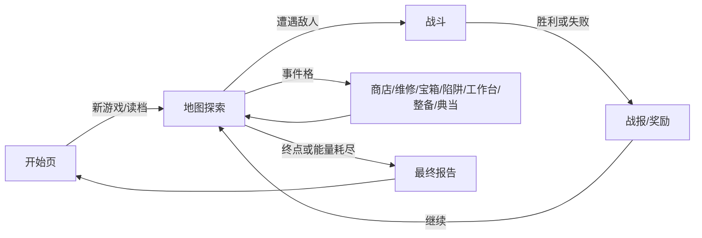
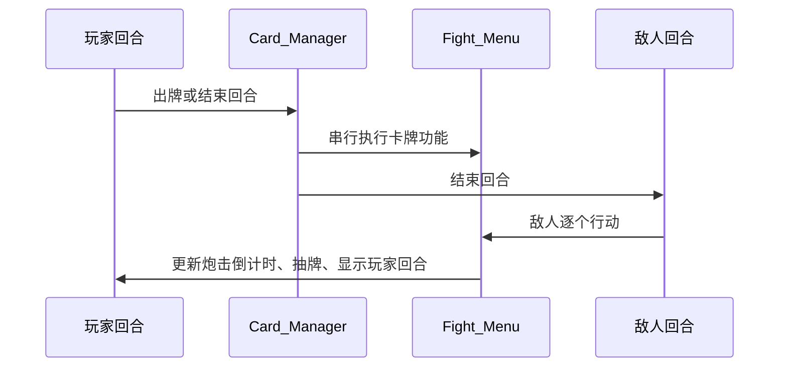

# 《装甲与战术》项目逻辑总览

> 本文以当前工作树中的 Godot 4.7 代码为准，供后续快速定位功能和排查问题使用。它描述的是现状；历史设计记录与当前代码不一致时，以代码为准。

## 1. 项目定位与运行入口

- 类型：像素风、回合制横向站位战棋 + 卡牌构筑游戏。
- 主场景：`scenes/Start.tscn`。
- 全局单例：`Profile`（`scripts/Profile.gd`），另有第三方 `PhantomCameraManager`。
- 主要状态都留存在 `Profile` 中，因此页面切换不会丢失玩家、地图位置、卡组和背包数据。



## 2. 全局数据与存档

### `Profile.gd`

`Profile` 是全局数据中心，承担以下职责：

| 数据/能力 | 说明 |
| --- | --- |
| `player` | `Profile.Player`，包含生命、当前三种武器和当前攻击模式。 |
| `item` | `Item` 资源：金币、能量、地图坐标/朝向、三类武器背包、统计数据、胜利次数。 |
| `Deck` | 牌库，元素为 `Card`。战斗开始时会复制成战斗内牌堆，战斗不直接消耗永久牌库。 |
| `CharacterArray` | 本场战斗的角色配置来源；战斗场景会据此实例化 `Character` 节点。 |
| 随机生成 | 随机卡牌、商店卡牌、随机武器、商店优质武器。 |
| 敌人配置 | `enemy_seed_list` 按已完成次数提供敌方部署方案。 |

新游戏由 `Profile.start_new()` 初始化玩家、物品、初始牌库和测试武器。`fill_test_weapons()` 目前仍会给三个武器背包填入测试武器，这属于当前体验的一部分。

### `Item.gd`

- 三个背包：`meleeBag`、`shootBag`、`shellingBag`，当前装备也位于各自背包中。
- `energy` 初始为 `Profile.max_energy`（15）；地图普通格移动会消耗 1 点。
- `map_location`、`direction`、`towards` 用于回到地图后复位机器人。
- `enemy_kill`、`miss_time`、`attack_times`、`move_step`、`finished_times` 用于结算和难度成长。

### 存档

- 存档对象：`SaveData`（`Resource`）。
- 存档路径：`user://savadata/save.tres`。
- 保存：地图的“退出”操作以及开始页退出会调用 `SaveData.save_data()`。
- 卡牌不直接保存节点，而保存每张卡的功能 `id` 数组；读档后由 `Profile.id_to_function()` 重建。
- 最终报告的返回主页按钮会删除该存档。

## 3. 主流程：开始页与地图探索

### 开始页 `start_page.gd`

- 新游戏：`Profile.start_new()` 后进入 `map.tscn`。
- 读档：`Profile.load_data()` 后进入地图；无存档时读档按钮禁用。
- 标题文字持续打乱，作为故障风格视觉效果。

### 地图 `map_manager.gd`

地图使用 `TileMapLayer`，机器人按地图格坐标移动。地图流程如下：

1. 进入地图后，根据 `Profile.item.map_location` 还原位置与方向。
2. 非战斗返回时掷骰，步数随机为 `1..min(能量, 9)`；战斗中断返回时恢复 `remained_step`。
3. 每到普通格（tile id 小于 14）消耗一步、1 点能量，并播放能量条动画。
4. 转弯格会改写行进方向；岔路格 `18/19` 暂停并让玩家选择方向。
5. 步数耗尽后进入当前格事件；若能量耗尽则进入失败流程。

| 地图格 id | 当前行为 |
| --- | --- |
| 1 | 重掷骰子。 |
| 2 | 获得 3 点能量后重掷。 |
| 3 | 陷阱。 |
| 4 | 商店。 |
| 5 | 整备间。 |
| 6 | 工作台。 |
| 7 | 典当行。 |
| 8 | 以物易物：目前仅打印提示，未接入页面。 |
| 10 | 进入战斗；若经过该格且仍有步数，也会中断并战斗。 |
| 11 | 维修间。 |
| 12 | 宝箱。 |
| 20 | 最终报告。 |

地图的角色、牌库和设置按钮通过 `information/cmd` 控制台式界面展示。打开界面会设置 `_ui_open`，阻止自动移动在页面打开时继续推进。

## 4. 战斗系统

### 4.1 场地、角色和回合

- 战斗场景：`scenes/fight_menu.tscn`；控制器：`fight_menu.gd`（`Main_menu`）。
- 场地为 11 个连续的 `Position` 块。玩家通常从左侧开始，敌人由 `Profile.enemy_seed_list` 生成。
- `Character` 是战斗节点，`setting` 指向 `Profile.Player` 或 `Profile.Enemy` 数据对象。
- 开场顺序：部署角色 → 默认锁定第一个敌人 → 显示攻击范围 → 抽 7 张牌 → 玩家行动。



敌人当前已有的行为枚举：基础近战、基础射击、基础炮击、不可移动、变异体。实际配置中已有近战 `MR_1`、射击 `SR_1`、炮击 `SLR_1`；变异体的双模式切换仍只有框架。

### 4.2 三种攻击模式

| 模式 | 数据类 | 当前规则 |
| --- | --- | --- |
| 近战 | `Melee` | 向右攻击一定格数；命中范围内所有敌人。移动时会尝试原方向，受阻则向反方向弹回。 |
| 射击 | `Shoot` / `Through_shoot` | 普通射击攻击锁定敌人；贯穿射击按等级攻击多个敌人。当前没有友军遮挡，射击默认可判定命中。 |
| 炮击 | `Shelling` | 先锁定，跨回合计时，倒计时结束再命中；普通炮击可追踪锁定目标，多目标炮击打全部敌人，溅射炮击攻击目标周边位置。 |

武器扩展：`Through_shoot`、`Multi_target_missile`、`Sputtering_type_artillery`；炮击可装备燃烧弹、闪光弹、干扰弹。

### 4.3 敌人 AI

- 近战敌人：能攻击时会比较队友潜在伤害；玩家处于近战模式且队友伤害更高时优先压位，否则攻击；不能攻击则向玩家移动。
- 射击敌人：不移动，直接射击。
- 炮击敌人：不移动，锁定玩家并按自身 `is_targeting/current_time` 结算，多个炮击敌人不再共用一个锁定状态。
- 角色死亡：玩家死亡进入失败战报；所有敌人死亡进入胜利战报，并按敌人奖励增加金币。

### 4.4 BUFF

BUFF 存于 `Character.buffs`，同类 BUFF 叠加层数。临时 BUFF 在持有者回合开始时减一层，归零移除。

| BUFF | 触发/来源 | 现有代码效果 |
| --- | --- | --- |
| `Fragile`（易伤） | 射击未命中后给攻击者 | 受伤时伤害乘以 1.5。 |
| `Overheated`（过热） | 燃烧弹 | 近战范围减少层数，伤害增加。 |
| `Blinded`（致盲） | 闪光弹 | 射击命中率每层减 15%。 |
| `Dud`（哑火） | 干扰弹 | 炮击危险范围显示额外等待层数。 |

`PermanentBuff` 的设计意图已预留在管理接口中，但当前没有具体常驻 BUFF 子类投入玩法。

## 5. 卡牌与栈系统

### 卡牌结构

每张 `Card` 最多四个功能格，功能对象来自 `card.gd` 的内部类：

| 功能 | 作用 |
| --- | --- |
| 前进 / 后退 | 移动玩家一格；受边界和占位限制。 |
| 丢弃 1 / 2 | 进入选牌并提交的弃牌交互。 |
| 抽 1 / 2 / 3 | 从战斗牌堆抽取。弃牌堆会在牌堆耗尽后洗回。 |
| 加载 | 选择一张手牌，使其栈类型与刚打出的卡一致。 |
| 替换 | 选择两张有栈手牌，交换栈类型和栈位置。 |
| 攻击 | 调用当前攻击模式。 |
| 调节 | 近战 → 射击 → 炮击 → 近战循环。 |
| 一次性 / 消耗 | 控制卡牌的离场去向。 |
| 封锁 / 空白 | 锁格和 DIY 改造用空位，不执行常规功能。 |

### 栈规则

每张战斗手牌拥有一个栈类型与栈位置（左/中/右）。覆盖关系为：

```text
Melee → Shoot → Shelling → Melee
```

- 空槽可直接放入。
- 同类不可覆盖。
- 只有克制链的下一种可覆盖。
- 三个栈都成为同一类型时，对应武器临时增加攻击力，随后清空栈条。

### 执行时序

`Card_Manager` 负责 `_anim_queue`。出牌后先处理栈与卡牌离场动画，再把功能对应的 `AnimationUnit` 放入队列，使用 `await` 串行执行。弃牌、加载、替换等需要玩家继续选择的功能会暂停队列，直到提交或退出交互。

> 注意：历史记录曾写“炮击等待期间重复使用攻击模块会叠加 `bonus_damage`”，但当前代码中的累加语句已注释，当前版本不会累积这部分额外伤害。

## 6. 地图事件与经济模块

| 页面 | 控制器 | 当前功能 |
| --- | --- | --- |
| 商店 | `shop.gd` | 生成 6 张偏高品质卡牌和三类优质武器；可购买能量。武器商品依赖 `Weapon_commodity`。 |
| 整备间 | `equipment_adjustment.gd` | 从三个武器背包中选取并装备近战、射击或炮击武器。 |
| 工作台 | `workshop.gd` | 扩容：将锁格改为空白格；改写：拆解其他卡获得功能，再填入空白格，最终检查总点数不超过 10。 |
| 典当行 | `pawn.gd` | 出售未装备武器，按武器估价增加金币。 |
| 维修间 | `repair.gd` | 免费、普通、VIP 三个维修/升级入口；价格和平衡仍是待调整项。 |
| 宝箱 | `treasure.gd` | 随机提供能量、金币、强化卡或武器；玩家选择拿取或忽略。 |
| 陷阱 | `trap.gd` | 从金币、能量、使用次数最高的卡、最有价值的未装备武器中随机扣除一个合法目标。 |

陷阱的可选池会先过滤不合法项：始终可扣金币；能量足够才扣能量；有卡才扣卡；存在未装备武器才扣武器。这样避免因空内容而选择不可执行的页面。

## 7. 战报、奖励与最终结算

### 战报 `news.gd`

- 胜利：`finished_times` 加一，按当前状态选择卡牌、武器、维修或电池奖励。
- 失败：进入最终报告。
- 奖励分支：
  - 卡牌奖励：生成四张模组组合不重复的随机卡，选择一张加入永久牌库。
  - 武器奖励：随机武器，可收下加入对应背包或跳过。
  - 维修奖励：恢复 30 点生命。
  - 电池奖励：恢复 3–6 点能量。

### 最终报告 `final_report.gd`

展示击杀数、移动步数、攻击次数、失误次数和游戏时长；返回主页时删除存档。

## 8. 后续排查优先级

以下内容已在当前代码或项目记录中确认，修改相关模块时应先核对：

1. **炮击敌人死亡/队友死亡后的倒计时**：项目 `目前bug.txt` 标记为未解决，需要以多炮击敌人的真实战斗流程复现。
2. **陷阱空内容**：`randomIndex()` 已加入过滤，但仍需实际运行验证卡牌节点移动与销毁后不会留下空页面或悬空引用。
3. **维修经济平衡**：`目前bug.txt` 标记为“维修有点太便宜”，属于数值设计调整而不是单纯程序错误。
4. **未完成功能**：地图 id 8 的以物易物、射击友军遮挡、变异体双模式切换尚未实现完整玩法。
5. **遗留资源**：`scenes/Effects/damage_text.tscn` 引用了不存在的 `scripts/damage_text.gd`；现行伤害预览实际使用 `Character.damage_label`，该场景看起来是未清理的旧实现。
6. **静态类型告警**：`Character.gd` 和 `fight_menu.gd` 存在 `PackedScene.instantiate()` 的弱推断告警；当前未必阻断运行，但后续提高 GDScript 警告级别时可能成为问题。

## 9. 修改时的快速定位

| 要改的内容 | 优先查看 |
| --- | --- |
| 新/改地图事件 | `scripts/map_manager.gd` 与事件场景控制器。 |
| 改攻击、AI、胜负 | `scripts/fight_menu.gd`、`scripts/Character.gd`、`scripts/Weapon/`。 |
| 改卡牌功能或栈规则 | `scripts/card.gd`、`scripts/card_manager.gd`、`scripts/stack.gd`、`scripts/Profile.gd`。 |
| 改 BUFF | `scripts/buff.gd`、`scripts/Character.gd`、`scripts/fight_menu.gd`。 |
| 改奖励、卡牌/武器随机 | `scripts/Profile.gd`、`scripts/reward_branch/`。 |
| 改装备与背包 | `scripts/Item.gd`、`scripts/equipment_adjustment.gd`、`scripts/weapon_select.gd`。 |
| 改存档 | `scripts/SaveData.gd`、`scripts/Profile.gd`。 |

